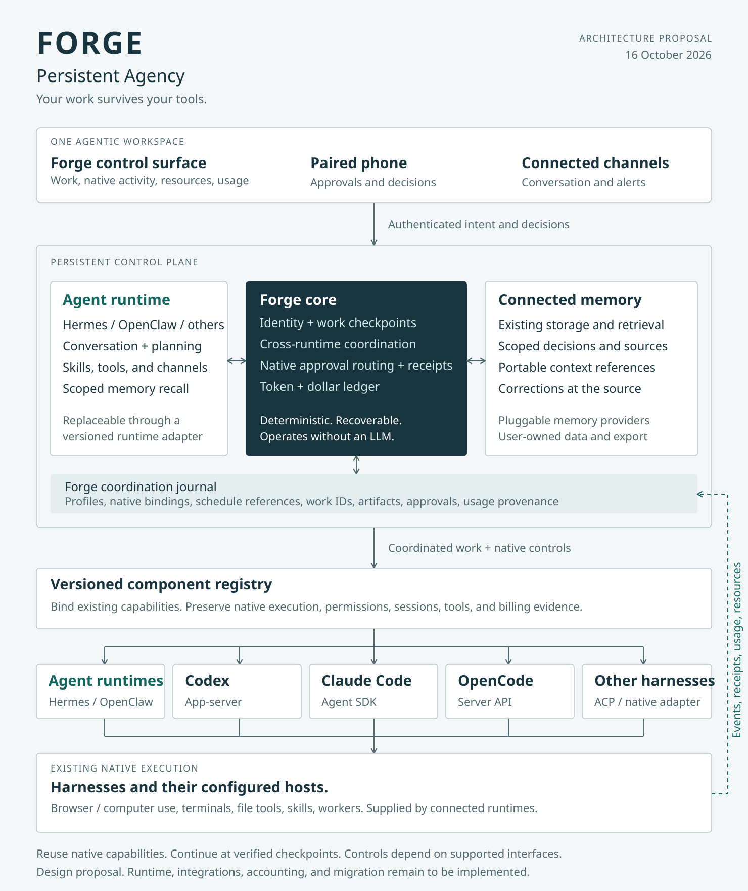

# Forge

**Your work survives your tools.**

Forge is an open-source local workspace for people who work across AI runtimes and harnesses. It keeps work records, context, native account references, approval receipts, machine resources, and usage evidence together. Native tools supply execution. Hermes is an important integration and remains replaceable.

We call the product concept **Persistent Agency**: your agent profile, memory, workspace, work history, shared connections, schedules, and policies remain in Forge while you change a compatible execution harness at a verified checkpoint.

**Status: early local application, v0.27.0.** Persistent work/profiles, scoped native memory and private portable copies, reviewed setup blueprints, account routing, private credential references, spending admission, native activity, a shared-sample resource map and private diagnostics, optional ntfy alerts, reviewed macOS background activation, reviewed Hermes pause/resume and experimental Codex/Claude API/OpenCode/Hermes ACP/OpenClaw Gateway execution are implemented, including verified handoff around the same work and profile. The broader architecture remains a roadmap. Automatic continuation after uncertain effects, full companion lifecycle, other scheduler controls/ownership transfer, full memory-provider migration, live device/provider acceptance and hard resource enforcement remain open. See [the implementation and evidence](docs/RUNTIME.md) and [full completion audit](docs/COMPLETION_AUDIT.md).

[Native crash recovery](docs/NATIVE_RECOVERY.md) adds signed original-child closure, explicit interrupted-worker review and durable profile fences. It never replays native input or treats PID disappearance as exit.

The workspace now starts with your managed work and existing native chats, compact resource/usage status and exact pending approvals. Ctrl/Cmd K searches work and commands; optional creation fields stay folded until needed. See [the experience decisions and upstream references](docs/UI_EXPERIENCE.md).

## Run Forge

Use Node.js 24 or newer:

```sh
npm ci
npm run build
npm start
```

Open [the local workspace](http://127.0.0.1:4710). The real workspace starts empty. Use the workspace selector to explore clearly labeled fictional examples in a separate in-memory demo. Demo actions never start native execution. Machine telemetry is live in both views.

Create a work record, add a native account slot, and check a supported account from the Accounts view. For experimental managed Codex work, select the account and an existing project directory, then review the launch dialog. Native sign-in stays in the harness; Forge does not collect credentials or purchase credits. Each launch checks effective native account configuration and permissions. Claude managed turns use the official Agent SDK with API authentication and an explicit metered-usage choice; native claude.ai subscription sessions remain in their native client. [Claude setup and integration limits](docs/NATIVE_DRIVERS.md) explain this distinction.

OpenCode v2 reuses its official client and an owned native server. Configure a dedicated native profile root, select a model through native configuration, and review external/metered consent. [OpenCode setup, permissions and recovery](docs/OPENCODE.md) describe the supported route.

Hermes reuses its installed ACP runtime, native tools, memory and skills with an explicit native home. [Hermes setup, exact reviews and native outcome evidence](docs/HERMES.md) describe the tested 0.17.0 route.

OpenClaw reuses its native foreground Gateway and official client with a dedicated execution profile. [OpenClaw setup, native session identity and shutdown](docs/OPENCLAW.md) describe the evaluated 2026.10.4 route. Existing companion channels and schedules retain their native owner.

Existing Hermes, OpenClaw and other MCP clients can use [scoped companion access](docs/COMPANION_ACCESS.md) to keep the same Forge profile, selected memory and work. Optional native dispatch has explicit account, billing and finite-run grants; approvals stay on the human path. Forge adds no agent loop or scheduler.

[Native harness connectors](docs/NATIVE_CONNECTORS.md) register an installed ACP v1 agent without adding a provider-specific core driver. Reviewed executable/model/mode bindings use the same work, profiles, selected context and native approval path. Unknown usage and unsupported native behavior stay explicit.

[Workspace blueprints](docs/BLUEPRINTS.md) reuse setup roles and optional work templates. Bind your own native accounts and selected memory, review the import, and roll back unused setup. Existing native credentials, schedules and work retain their owners.

For phone review, the opt-in private gateway reuses Tailscale Serve and an explicit owner allowlist. [Phone setup and evidence](docs/PHONE_ACCESS.md) describe the authenticated route and the remaining live-device verification. The default service remains local.

[Notifications](docs/NOTIFICATIONS.md) reuse your existing ntfy destination for generic approval and attempt alerts. Private credentials stay outside SQLite/exports; uncertain deliveries are visible and never automatically retried. The native request still requires authenticated review in Forge.

To see existing work, open **Activity**, discover profile references, then read the sources you want. Codex and Claude session catalogs, Codex and Hermes schedule definitions, and existing Hermes/OpenClaw session APIs retain their native owners. An optional [native Hermes ticker check](docs/SCHEDULER_EVIDENCE.md) distinguishes recent, stale and unknown evidence without starting jobs. [Native activity coverage and setup](docs/NATIVE_ACTIVITY.md) explain the limits and private metadata handling.

T3 Code can supply an optional [native execution backend](docs/NATIVE_BACKENDS.md), with native provider instances/models, exact approvals, delegated run receipts and explicit context coverage. Its separate [read-only activity source](docs/T3_CODE.md) keeps its original scope. The two-instance artifact and credential proof passes; full native-history preservation and whole-stack adoption remain open.

Open **Memory** to create a persistent profile and pin scoped native Markdown files or sections. The launch dialog shows the current selection. Corrections invalidate stale reviews and start a fresh native conversation while retaining the work and earlier history. [Profile and memory setup](docs/MEMORY.md) explains scope, provenance and native ownership.

Private state is stored outside this repository. On macOS, the default is `~/Library/Application Support/Forge/workspace.sqlite`. Use `FORGE_DATA_DIR` or `node bin/forge.mjs --data-dir DIRECTORY` to select another location. `FORGE_PORT` or `--port` changes the loopback port. Stop a foreground service with Ctrl+C. [Opt-in macOS background operation](docs/BACKGROUND_SERVICE.md) reuses launchd for login startup and crash restart. Nothing installs a startup agent automatically; background schedules and native companion owners remain unchanged.

## What works today

- Persistent work, goals, context, checkpoints, revision conflict checks, user-selected context exports, and verified [Work Capsules and native handoff](docs/CONTINUITY.md).
- Stable profiles and native memory references, project/work scopes, reviewed input fingerprints, corrected-context isolation and selected-memory continuity across supported harnesses/accounts.
- Multiple account slots and reviewed ordered routing scoped to the project/profile, with fresh native identity/quota evidence, shared-limit handling and explicit billing choices.
- Managed monthly/work spending admission, atomic attempt reservations, native counter deltas, unknown-cost holds and separate operator acceptance. Estimates remain distinct from invoices.
- A shared execution coordinator for experimental Codex app-server, Claude Agent SDK API, OpenCode v2, Hermes ACP and OpenClaw Gateway turns, with one managed worker, supported exact approvals, cancellation, native session continuation, usage snapshots, and recovery receipts.
- Real CPU, OS memory, process RSS and service-memory visibility, with [managed native worker attribution](docs/RESOURCES.md) and direct review of owning work. A fresh native macOS pressure check holds new managed launches at reported warning/critical pressure; explicit observe-only mode and quiet mode remain available.
- Native activity across profile/account homes: Codex and Claude chats, byte-preserving Codex/Hermes schedule inventory, and capability-aware Hermes/OpenClaw session API observations.
- Optional Agent Deck session inventory and ccusage daily Claude reports through their installed native CLIs.
- Optional macOS user service with verified native installation ownership, start/status/stop/restart/removal and no automatic task replay after a crash.
- Optional generic ntfy alerts with private setup, durable delivery evidence, current-request checks and no uncertain-delivery retry.
- Responsive light/dark views, keyboard search, sanitized setup-blueprint export, and opt-in private phone access to the same workspace/inbox with recorded reviewer identity.

Native adapters have protocol/callback fixtures plus [repeatable native tool conformance checks](tests/native/README.md). Actual Codex, Claude, OpenCode, Hermes and OpenClaw native workers passed an approval, tool execution, exact artifact verification and usage reporting against local deterministic providers, with zero paid model calls. A native Codex-to-Claude-to-second-Claude-profile-to-OpenCode-to-Hermes-to-OpenClaw chain retains one work/profile identity, selected memory, its goal/checkpoint, six verified artifacts, six account usage scopes and six OS-checked native worker roots. A separate native check switches between two OpenCode profiles with distinct synthetic credentials and a verified artifact read. Inference is deterministic and local; live subscription/account isolation and real model quality remain unverified. Native limits, permissions, and compatibility still apply.

The figure below describes the broader architecture roadmap.



## The intended experience

- See what is running, what owns the resources, and what is waiting for a decision.
- Keep a durable record of project decisions, verified progress, artifacts, and relevant memory.
- Connect native browser/computer use, terminals, file tools, skills, and other capabilities through existing runtime interfaces.
- Choose a harness and model separately, with an explicit capability check before continuing work.
- Connect multiple native accounts per harness and continue the same work through eligible accounts, with visible limits and account attribution.
- Replace Hermes with OpenClaw, or another compatible runtime, while retaining Forge's agent profile and work history.
- Answer supported approval requests from desktop or an authenticated phone surface.
- Understand tokens, retries, cache usage, tool charges, and dollars per task and project.
- Preserve laptop headroom through admission control and cleanup of resources Forge owns.

The defining demonstration is a real task checkpointed in one harness, continued in another, with artifact checks, accounting continuity, and a single authorized executor. It must also recover correctly when a worker fails around an external action.

## Read the design

- [Current implementation, setup, and limits](docs/RUNTIME.md)
- [Background operation and macOS service setup](docs/BACKGROUND_SERVICE.md)
- [Private file/Keychain references for background account credentials](docs/CREDENTIAL_REFERENCES.md)
- [Native resource ownership and observation limits](docs/RESOURCES.md)
- [Private phone access and native approval review](docs/PHONE_ACCESS.md)
- [Optional ntfy alerts, private setup and delivery evidence](docs/NOTIFICATIONS.md)
- [Native OpenClaw execution, profile setup and conformance](docs/OPENCLAW.md)
- [Native Hermes execution, memory and conformance](docs/HERMES.md)
- [Native OpenCode profile setup and conformance](docs/OPENCODE.md)
- [Versioned native harness connectors](docs/NATIVE_CONNECTORS.md)
- [Native capability boundary](docs/NATIVE_BOUNDARY.md)
- [Native chats, schedules, sources and coverage](docs/NATIVE_ACTIVITY.md)
- [Native scheduler evidence, aging and remaining controls](docs/SCHEDULER_EVIDENCE.md)
- [Reviewed native Hermes pause/resume and outcome receipts](docs/NATIVE_SCHEDULE_CONTROLS.md)
- [Profiles, scoped native memory and corrections](docs/MEMORY.md)
- [Initial existing-solution audit](docs/REUSE_AUDIT.md)
- [Customizable workspace blueprints](docs/BLUEPRINTS.md)
- [Architecture and failure semantics](docs/ARCHITECTURE.md)
- [The intended workspace experience](docs/EXPERIENCE.md)
- [Harness interfaces and integration limits](docs/ADAPTERS.md)
- [Dynamic components and replacement rules](docs/COMPONENTS.md)
- [Multiple accounts and workspace continuity](docs/ACCOUNTS.md)
- [Ordered account routing, native evidence and safe continuation](docs/ACCOUNT_ROUTING.md)
- [Spending budgets, counter evidence and accepted work](docs/SPENDING.md)
- [Research, prior art, and evidence boundaries](docs/RESEARCH.md)
- [Product capabilities and delivery sequence](docs/PRODUCT.md)
- [Editable architecture diagram](docs/diagrams/architecture.mmd)
- [Harness handoff sequence](docs/diagrams/handoff.mmd)
- [Build log](BUILD_LOG.md) and [continuation handoff](HANDOFF.md)

## Design principles

The core operates without an LLM. A selected runtime such as Hermes or OpenClaw can plan and assist, while the core validates permissions, admission, state changes, and resource ownership. Runtimes, harnesses, model routes, memory providers, tools, skills, channels, and workers connect through versioned capability contracts. Native features remain available through extensions. Unsupported controls are visible as unavailable.

Forge builds adapters, continuity, and cross-runtime visibility. Browser automation, computer use, terminal and file execution, skills, memory engines, and native scheduling stay with their existing implementations. The [native boundary](docs/NATIVE_BOUNDARY.md) defines the scope.

Observation, cooperative management, and sandbox enforcement are different integration levels. Discovering an existing process or reading saved chat metadata does not grant control over its approvals or resource limits.

This design builds on published work on agent persistence, memory, and scheduling. Its research foundations are credited in [RESEARCH.md](docs/RESEARCH.md). Product differentiation and real-world reliability remain hypotheses to test.

## Contributing

Start with [CONTRIBUTING.md](CONTRIBUTING.md). Useful contributions include native adapter conformance, recorded synthetic fixtures, accessibility improvements, and evidence for existing components Forge can reuse. Distinguish documented upstream support from behavior you have tested. Never contribute private conversations, memory, credentials, billing records, or account data.

The project is available under the [MIT License](LICENSE). Runtime integrations retain their own licenses, authentication requirements, and upstream policies.
