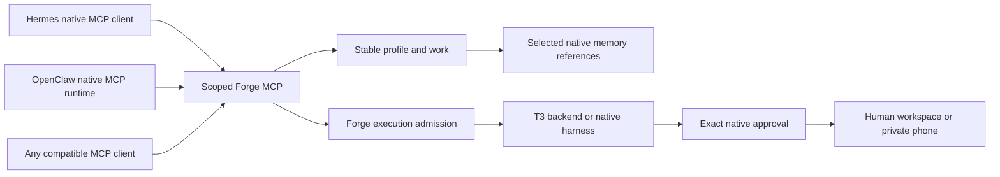

# Native companion access

For reviewed replacement, stable allowances/operation receipts and native readiness, read [companion handoffs](COMPANION_HANDOFF.md). The existing connection contract below remains available.

Forge contract 1 connects an existing Hermes, OpenClaw or compatible MCP client to a stable profile and project. The client keeps its model loop, tools, channels, memory engine and scheduler. Forge supplies durable work, selected context, native execution admission and receipts. Changing clients does not change Forge profile or work IDs.

## Connect

In **Connections → Companion access**, select a persistent profile, an existing project directory and access level. The grant covers work with that profile inside the directory and its subdirectories. Context access covers the profile's current and future selected memory, following each source's existing scope. Other profiles and neighboring projects are excluded.

Create access, then merge the displayed Hermes YAML, OpenClaw JSON or MCP entry into the client's private native configuration. The bearer is shown once and never placed in a URL, browser storage, snapshot, blueprint or provider environment. SQLite retains only its hash. Native provider credentials stay with their owners. Revoke and replace a lost credential.

The endpoint is `POST http://127.0.0.1:4710/mcp/companions`, adjusted for the Forge host/port. It uses the pinned official MCP SDK's JSON-only stateless Streamable HTTP transport. Supply a bearer in the Authorization header. Human CSRF credentials cannot authorize MCP; a companion bearer cannot authorize a human API request. Connect directly to the local service. The private phone gateway remains a human review surface.

Granting access creates no worker or model process. MCP modules load on demand, with at most four concurrent requests. Run counts, operation lookup and bounded history use SQLite indexes rather than loading every native run for each grant. Operation receipts reference canonical records instead of duplicating full context. Selected-account quota windows retain observation timestamps and shared bucket identity, with opaque scope hashes and unknown allowance preserved.

Read [retained context](COMPANION_HISTORY.md) for work/event/run pagination and complete saved event-detail chunks. Existing tool names and default calls remain compatible.

## Capabilities

| Scope           | Tools                                      | Effect                                                                                       |
| --------------- | ------------------------------------------ | -------------------------------------------------------------------------------------------- |
| `work:read`     | `forge_workspace`, `forge_work`            | Read bounded work and receipts in the granted profile/project                                |
| `context:read`  | `forge_context`                            | Read selected native memory, source hashes and a revision-bound context digest               |
| `work:write`    | `forge_create_work`, `forge_checkpoint`    | Save work or append attributed reference notes; no automatic launch or native memory rewrite |
| `work:dispatch` | `forge_start_work`, `forge_interrupt_work` | Start one admitted native attempt or request a stop of a run started by this grant           |

Dispatch is a separate explicit choice. It needs selected account bindings, context access, a finite limit of 1 to 1000 runs and a billing choice. Disabling metered usage retains native verified-allowance requirements. Native identity/permission checks, quiet mode, fresh pressure admission, context review, one managed execution slot and unsettled-run guards still apply. Revocation is rechecked after asynchronous preparation and before native construction. Changed account/model/home/credential bindings need new access.

The limit counts persisted attempts, including failures. It is **not a dollar budget**. Unknown prices or subscription allowance remain unknown. No tool grants approvals or rotates accounts automatically. Human decisions retain their exact correlated native path. Failed/interrupted work needs human reconciliation before another attempt.

Mutating tools require a stable request ID. Identical completed requests return their receipt; changed intent with the same ID is rejected. Lost launch responses are matched to persisted companion/run correlation. An uncertain operation is not replayed. Work creation/checkpoints commit operation receipts atomically. Each grant retains up to 2048 operation receipts before requiring replacement.

Created work, launches and checkpoints retain companion attribution through continuation and portable checkpoints. Notes are not relabeled as user instructions. Context reads do not rewrite native memory. Revocation blocks future calls and preserves work; existing native runs keep their original owner and ordinary stop/settlement flow.

## API and lifecycle

Local human setup uses `POST /api/companions` with `label`, `profileId`, `root`, `scopes`, optional `accountIds`, `dispatch` and `expiresInDays` (1 to 90, default 30). Dispatch contains `allowMetered` and `maxRuns`. The response includes the public grant, endpoint and one-time bearer. `GET /api/companions` and snapshots return public metadata. `DELETE /api/companions/:id` revokes future access. Active grants prevent deletion of their profile.

The original access contract used state version 4. State 8 now protects replacement lifecycle and lineage semantics; older readers refuse the upgraded workspace. Grants are excluded from shareable blueprints. A native client runs with its own OS permissions: the grant constrains these MCP tools and does not sandbox the native runtime or other local processes.

## Evidence and remaining work

`npm run test:native:companion` uses installed Hermes MCP discovery/registry calls to read selected memory, append an idempotent checkpoint and save idempotent work. Native memory bytes stay unchanged. A separately granted official SDK client retains the same work/profile after revocation.

Set `FORGE_OPENCLAW_BINARY` and `FORGE_OPENCLAW_NODE` to also check OpenClaw 2026.10.4. Its isolated native MCP runtime continues the Hermes work and selected context. Only this fixture imports that version's bundled runtime; production Forge imports no private OpenClaw module. No private home, schedule, provider credential or inference request is used.

The T3 check also dispatches native Codex work through MCP, crashes compiled Forge at a pending approval, restarts on the same port and repeats the request ID. It returns the same saved run without replaying an approval or model turn. Other launches remain blocked until exact native cancellation/settlement.

Always-on planner behavior, heartbeat delivery across runtime replacement, native memory search/migration, additional runtime conformance, notifications, dollar budgets and the rest of the [full completion audit](COMPLETION_AUDIT.md) remain open. Standard MCP compatibility does not prove every client's lifecycle or configuration format.
