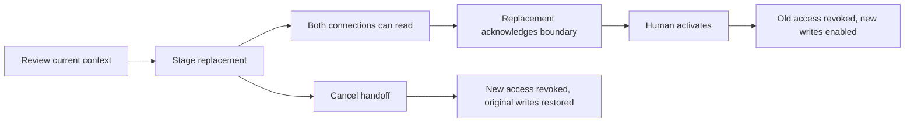

# Replace a native companion connection

Forge v0.28 can replace a Hermes, OpenClaw or other compatible MCP connection at a reviewed boundary. Work, profile IDs, selected native memory references, account bindings, expiry and remaining run allowance are retained. Native tools, models, channels, hidden conversation state and schedules keep their native owners.

## Review and stage

In **Connections → Companion access**, choose **Replace** on an active connection. Review the existing project/profile, selected reference count, saved work count, access scopes and finite allowance. This reads selected-file hashes, project identity, work revisions and native account bindings. It starts no model, planner, schedule or native worker.

Staging commits two access states and a durable receipt in one SQLite transaction: the original becomes `draining` and the replacement becomes `staged`. Both may read permitted work and context; neither may create work, append checkpoints or dispatch a native attempt. Current native execution must settle before staging. In v0.30, any [managed native source gateway](COMPANION_RUNTIME.md) must also stop and confirm original closure before preparing the replacement; its lifecycle binding is included in the reviewed digest. Unconfirmed native or delegated attempts in this project, including human-started attempts, cannot be bypassed through replacement.

The new connection secret is shown once on the host, using the existing native MCP configuration formats. Only its hash is retained. Repeating the same stage returns metadata without another secret. If the response or secret is lost, cancel the staged handoff and prepare a fresh one. No target native configuration is silently edited.

## Native readiness and activation

Connect the replacement native client. Read `forge_workspace` to obtain its lifecycle and handoff boundary. Read permitted `forge_context` for relevant work, then call `forge_companion_ready` with the `handoffId` and `digest` from the workspace. This acknowledgement is tied to the authenticated replacement grant. The original cannot acknowledge the replacement's boundary.

Tool discovery stays stable because native clients may cache their tool lists. Every write independently checks current lifecycle authority. A staged client cannot use a cached write tool; an activated client can continue with the same connection. Readiness grants no execution authority and does not attest to hidden-state import or a running native planner.

After reviewing native planners, schedules and external work, activate from the local workspace or authenticated private phone gateway. Activation checks the current receipt revision, boundary digest, profile, selected-file hashes, account bindings and work state again. One transaction revokes the original grant and enables the replacement. The human review actor is retained. The original token cannot authorize cached operations after activation.

If context changes, activation is held. **Refresh context boundary** creates a new digest, clears readiness and requires another native acknowledgement. Cancellation revokes the staged token and restores the original access state without resurrecting a manually revoked or expired grant. Activated handoffs cannot be rewound by cancellation; replace the active connection again when another transition is needed.

Restart preserves staged/draining states. It does not replay setup, activate a replacement, resume original writes or recover a secret. Graceful shutdown waits for an admitted checkpoint to finish before closing canonical storage.

## Allowance and operation continuity

Replacement inherits the original scopes, accounts, billing choice and expiry. It also inherits a stable lineage ID. Persisted native run counts and the 2,048-operation bound are shared across that lineage, including legacy original-grant records. Replacing a client cannot reset a finite run allowance or extend its expiry.

Idempotency uses the lineage and the original `requestId`. The replacement can retrieve an already committed work/checkpoint/run result without creating it again. Pending or uncertain outcomes retain their existing guards. Source actors and labels stay attached to original records. Neither native approvals nor external actions are replayed.

## Live workspace changes

The human UI uses `GET /api/changes` for payload-free server-sent invalidations. It subscribes to durable work, approval, access and setup changes after commit. Events contain no work content, source names, identifiers, credentials or control instructions. Native MCP bearer credentials cannot subscribe through the human endpoint; demo does not subscribe to local changes.

The existing HTTP process serves at most 16 views. Bursts coalesce, slow consumers disconnect, transport keepalives run only while views are connected, and streams end before server shutdown. Browser invalidations coalesce and older snapshot responses cannot overwrite newer requests. Resource/usage sampling and five-second polling remain available as fallback. This transport does not add a scheduler, agent, event-history store or native observer process.

## Compatibility and rollback

State 9 additionally protects owned native runtime reservations; read [native lifecycle compatibility](COMPANION_RUNTIME.md). State 8 introduced connection lifecycle and lineage semantics. A state-7 file workspace receives a mode-0600 native `before-v8` rollback copy, and the previous compiled reader refuses the new state. Setup blueprints do not contain live grants, handoff receipts or secrets.

Keep newer state and native profiles/proofs separately when inspecting a rollback. Restoring a pre-handoff authorization database can resurrect old access hashes and omit later run counts; inspect it on an isolated address and reconcile/revoke old access before serving it again. A source rollback does not establish native settlement or undo external effects.

This connection handoff does not transfer native cron ownership, stop foreign planners, migrate native memory engines/tools/policies or guarantee lossless hidden conversation state. Capability discovery remains necessary: current [Hermes API documentation](https://hermes-agent.nousresearch.com/docs/user-guide/features/api-server) and [OpenClaw Gateway protocol](https://docs.openclaw.ai/gateway/protocol) describe native surfaces, but an advertised operation alone does not prove exact-request control on an installed version. Reviewed start/stop of supported owned native planners is now available through [native companion lifecycle](COMPANION_RUNTIME.md). Broader planner providers and scheduler ownership transfer remain in the [completion audit](COMPLETION_AUDIT.md).

## Verification

Functional checks cover staged write refusal, authenticated readiness, stale memory/work/bindings, shared finite allowance and request namespace, atomic rollback, missing-secret replay, private phone review, cancellation, native uncertainty and restart/shutdown. Browser checks use a real MCP connection through staging and activation, retain the work/profile, inspect both themes/mobile, check inner overflow and run accessibility checks.

`npm run test:native:companion` now verifies staged readiness through the installed Hermes MCP client. With the existing native OpenClaw overrides, actual OpenClaw prepares the replacement read-only, acknowledges its boundary, then continues the same work after activation. The official MCP SDK confirms retained context and old-token revocation. `npm run test:native:memory-packs` repeats the path after removal of the original memory file. Native memory bytes stay unchanged and these fixtures make zero model calls. This evidence does not establish live provider/device acceptance or full framework completion.
