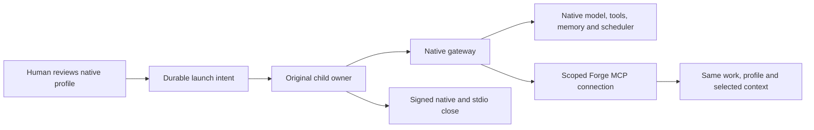

# Native companion lifecycle

Forge v0.30 can start and stop a supported native Hermes or OpenClaw gateway from **Connections → Companion access → Native runtimes**. The gateway keeps its native model, tools, channels, memory, permissions and scheduler. Forge supplies a reviewed lifecycle and durable connection context through its existing contracts.

## Set up and start

1. Configure the native gateway using its own tools. Use an explicit native profile with its intended interfaces, credentials, channels and schedule settings.
2. Add that native account in Forge and create scoped companion access for the intended project/profile. Link the account and access under Native runtimes. Linking starts no process.
3. Choose **Review start**. Review the account, project, native home and configuration fingerprints. Explicitly accept the native activity and provider spending policy before starting.
4. Forge returns a durable starting receipt before waiting for native readiness. The dashboard receives lifecycle changes through the existing payload-free change stream.

Configuration values and secret file contents are not returned in the review. Bounded SHA-256 fingerprints of the provider's declared files bind the review; changing those files requires a new review. Reviews expire after two minutes. The same launch ID and digest return the original receipt without starting another process.

Native gateway spending follows its native policy and is outside Forge's per-work spending reservations. Native gateway approvals keep their native interfaces; starting a companion does not establish exact-request forwarding into the Forge inbox. Configure native access and spending accordingly. The separate managed execution adapters retain their existing exact approvals and accounting.

| Provider | Evaluated native contract                            | Startup behavior                                                                                                                                                               |
| -------- | ---------------------------------------------------- | ------------------------------------------------------------------------------------------------------------------------------------------------------------------------------ |
| Hermes   | 0.17.0, public `gateway.run.start_gateway`           | Preserves configured channels and API address/key. Refuses multi-profile multiplexing. Readiness checks the native status record against the original child.                   |
| OpenClaw | 2026.10.4, native `gateway run` and `gateway health` | Requires a local gateway with native reload off. Preserves its configured address, port, authentication and channels. No service install/start/replace operation is requested. |

Supported lifecycle ownership requires a persistent file-backed Forge workspace on macOS or Linux. Native installation/version and profile compatibility are checked before accepting readiness. In-memory demo workspaces do not start gateways. Provider definitions use contract version 1; this is an integration interface, not a general downloaded-plugin installer.

## Ownership and resource use

One native companion launch may be open for a Forge profile at a time. The existing workspace checkpoint excludes conflicting setup and checks quiet mode, fresh memory pressure and unsettled native execution before starting. A healthy companion can coexist with separately admitted Forge work. Starting, stopping or unresolved lifecycle evidence retains the relevant setup/admission guards.

The existing child-owner protocol durably prepares and commits before its sole native spawn. Signals use that original handle. Native argv, provider material and signing keys travel over private IPC. A native-profile fence and lease prevent another cooperating Forge client from opening the same explicit profile during uncertain cleanup.

Resources appear as a **Native companion runtime** group in the shared OS sample, including the child owner and observed descendants. A companion is not a fabricated Work or Run. The actual native PID is recorded separately from the owner used as the resource root. Metrics never authorize process adoption, signals or release of a hold. No child owner or readiness observer remains running for a runtime that has not been explicitly started.

## Stop, recover and replace

**Stop** targets the current launch, requests native cleanup and retains its lifecycle reservation until original native and inherited-stdio closure is confirmed. Native cleanup can take several minutes. Repeated stops cannot target a later launch. Graceful host shutdown drains its owned gateways before closing canonical storage.

A host restart holds unclosed launches as unknown. It never automatically starts a gateway or replays a prompt, schedule, configuration mutation or approval. When the original child owner has produced exact signed close evidence, a human can reconcile its current digest/revision from the host or authenticated private phone gateway. Missing or invalid evidence stays held. Foreign processes, killed owners and unsupported legacy launches cannot be cleared by PID disappearance or an arbitrary force-clear action.

An unexpected close or lost owner appears in the workspace attention list. If the existing optional notification destination is enabled for failures, the current launch generates one generic attention notification. No native content, profile paths, account identity or approval action is sent. Existing outbox uncertainty and no-resend rules apply.

Before [replacing companion access](COMPANION_HANDOFF.md), stop and reconcile any managed source gateway. The handoff digest includes that lifecycle boundary. Stage the replacement access, configure its native client, start its reviewed native runtime, obtain the target's authenticated readiness acknowledgement and activate through human review. Work/profile identity, selected context, remaining access allowance and operation lineage stay canonical in Forge.

Native schedule definitions remain in their own profiles. The lifecycle does not translate job definitions, migrate learned-memory engines, stop foreign planners or prove detached/external effects settled. Scheduler-owner transfer, broader providers and live account/device acceptance remain in the [completion audit](COMPLETION_AUDIT.md).

## Compatibility and verification

State 9 protects native lifecycle reservations from older readers. An existing file workspace receives a mode-0600 `workspace.sqlite.before-v9.UUID.sqlite` backup. The v0.29 state-8 reader refuses the new state. Retain native profiles and private worker proofs separately. Restoring an earlier database does not undo native side effects or establish settlement; inspect rollback copies on an isolated address before serving old access.

Functional checks cover real inert-child ownership, idempotent start/stop, pre-spawn cancellation, review changes, access boundaries, source-stop fencing, resource partitioning and human reconciliation after restart. Browser checks exercise the same route on desktop and phone, including accessibility, scrolling review content and reachable actions.

`npm run test:native:companion-lifecycle` starts actual supported Hermes and OpenClaw gateways in temporary profiles, checks their original configured interfaces/authentication, retains native scheduler configuration and selected memory, and obtains two signed closes. Both runtimes use the same Forge work/profile through a staged access handoff. Configuration/memory bytes stay unchanged and an instrumented loopback model endpoint records zero model requests. The fixture has no runnable job; it does not establish native job delivery, model quality, real billing, actual device push or full framework completion. [Native test setup](../tests/native/README.md).
