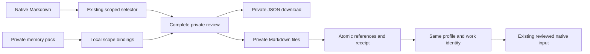

# Private portable memory

Forge v0.25 preserves reviewed selected memory as ordinary Markdown independently of a Hermes, OpenClaw or other native home. It reuses the [profile/context reader](MEMORY.md), scope checks and continuation seals. It adds no search index, embeddings, extraction loop or second memory engine.

## Copy or export

In **Memory**, select a saved profile and choose **Prepare portable copy**. Save profile edits first. The two-minute review shows every selected entry, complete text, retained instructions, scope and private destination. Unselected sections are excluded.

Choose **Use portable files** to create private Markdown under `memory-packs/OPERATION_UUID/` in the Forge data directory. Profile ID, name and companion remain unchanged. References, affected work revisions and the operation receipt commit atomically. Original native files and unpinned references remain unchanged. The next launch needs its current context review; incompatible older assistant excerpts are excluded by existing continuity rules.

Alternatively choose **Download private pack** to export version 1 JSON without activating references. It contains selected text, profile instructions and local path provenance. Store it privately. This explicit export is separate from the shareable setup blueprint. It reads no credential store and carries no account, companion grant or saved execution permission.

Copies are snapshots. Later native memory-tool writes or edits do not synchronize. Re-export current selections through a fresh review when needed. Copies survive removal of the original companion home while the Forge data directory is retained. Backups and retention of that directory remain the user's responsibility.

## Import and scope

Choose **Import private pack**, select its JSON file or paste the definition, then bind scopes locally. Global entries stay global within the chosen profile. Project entries require an explicit local directory. Work entries require an existing local work record using this profile. Binding cannot change the pack's declared scope kind. Imported provenance is a claim with content hashes, not proof of authorship.

Import replaces the target profile's pinned memory set after review. Existing instructions are kept by default; replacement requires the explicit instruction choice and review of incoming text. Profile ID and companion stay in place. Missing original source files do not prevent importing a valid pack to recover context. Every entry must match its SHA-256 and canonical UTF-8/LF Markdown. Unknown fields, duplicate keys, missing bindings and embedded authority are rejected.

Unpinning or forgetting a reference stops future selection. It does not delete Markdown copies, manifests, downloads or earlier native conversations. Correct active Markdown with its native editor and review the changed context before another launch. Previous manifests and exports remain historical snapshots until removed by the user.

## Ownership and recovery

Only a local human with current workspace protection can prepare, import, export or activate packs. Demo, paired-phone setup and MCP bearer credentials cannot provision them. Scoped companions consume selected context through existing work/profile grants after human activation.

Preparation writes no files. Managed work and setup are excluded during preparation/activation. The operation uses one bounded slot, up to eight short-lived plans and no new worker process. Shutdown waits for the current operation. Packs allow eight entries, 32,000 characters per entry and 256 KiB of canonical JSON. The existing per-work 32,000-character input limit still applies. Oversized selections are refused without truncation.

Activation persists `staging` before creating a new owned directory and exclusive mode-0600 files, with mode 0700 directories where Unix permissions apply. The root must be private/user-owned; a symlink cannot redirect installation. Sources, profile revisions, scope and destination are revalidated. The final SQLite transaction adds verified references, updates profile/work revisions and records `applied` together.

Failed or interrupted staging cannot partially commit bindings. Startup records failure without replaying installation or adopting partial files; partial private copies remain for inspection. Repeating an operation ID returns its recorded outcome. Another attempt needs a fresh explicit review. This establishes cooperative local ownership, not protection from an attacker controlling the same user account. Windows ACL acceptance remains open.

State remains version 6. Receipt metadata is additive; registered sources use the existing Markdown/context contract. Older state-6 readers can read those ordinary references but do not expose pack management. Preserve the preceding checkpoint and private SQLite backup when evaluating rollback.

## Evidence and API

Functional checks cover selection-only export, unchanged native bytes, stable identity, original-home removal, stale reviews, scope binding, instruction retention/replacement, atomic rollback, staging recovery, idempotency, local-human authority and symlink refusal. Browser coverage includes both themes, narrow dialog overflow/footers, unsaved-edit protection, private download, local project binding, instruction choice, reload and axe.

`npm run test:native:memory-packs` uses actual installed Hermes MCP and the official replacement client after removing the original memory path. Supported `FORGE_OPENCLAW_BINARY` and optional `FORGE_OPENCLAW_NODE` overrides also enable the actual OpenClaw MCP runtime. Both installed native clients passed the same work/profile, selected-marker exclusion, idempotent work/checkpoint and revocation checks against an owned isolated workspace, with zero model calls. This proves selected-context portability, not migration of a provider's search index, learning tools, policies, native session history or scheduler ownership.

The local API provides `POST /api/memory/packs/copy`, `/parse`, `/import`, `/export` and `/apply`. Export/apply require the plan ID, digest and `reviewed: true`. `GET /api/memory/packs` returns receipts; `/schema` describes the strict versioned import/binding contract. No generic tool proxy is added. Remaining [full framework requirements](COMPLETION_AUDIT.md) stay explicit.
