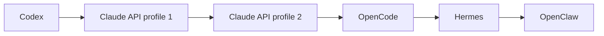

# One task across five harnesses

The v0.40 native conformance check runs this chain:



All six attempts use the same canonical work and selected profile/memory. Each destination reads the preceding artifact using its own native tools and creates the next checked artifact. The test checks source closure, handoff context/artifact fingerprints, separate account usage, exact native approvals and disjoint OS worker attribution. It does not implement another model loop or tool stack.

## Recorded result

The 18 October 2026 rerun passed six completed attempts, six verified artifacts, six signed original-child/stdio closes, seven exact approvals and six account usage scopes. Private context, project paths and work IDs were absent from the public receipt.

These are actual installed native tools with deterministic loopback inference in temporary profiles. Paid model calls are zero. This establishes the tested tool/protocol/continuity path, not live subscription isolation, invoice pricing, model quality or lossless hidden-state portability. USD figures below are synthetic native estimates and incomplete.

The public receipt, with grammar normalized for reading:

```text
One work. Multiple harnesses.

Codex -> Claude -> OpenCode -> Hermes -> OpenClaw

One canonical work record
6 attempts; 6 completed
6 original-process closures recorded
1 saved checkpoint
7 accepted approvals; 0 pending
1224 reported tokens
$0.0009 estimated USD (not an invoice); coverage incomplete
```

Consecutive Claude attempts collapse to one harness name in the public sequence. Private profile/account identifiers are excluded; the six attempt count remains.

## Reproduce

Build Forge, install/configure the evaluated native tools and follow [native conformance setup](../tests/native/README.md). Run npm run test:native:handoff. Absolute OpenClaw binary/compatible native Node and Hermes Python overrides may be needed when those installations are outside PATH. Do not use personal provider keys or profiles for this fixture.

The test uses only its temporary native profiles and explicit local providers, checks private-content canaries on the receipt and removes its temporary workspace after closing original owned processes.

The [fictional in-app example](PUBLIC_ALPHA.md) is for exploration without native setup. It is independently labeled and must not be presented as this real conformance run. Read [the public receipt contract](PUBLIC_RECEIPTS.md) and [remaining original scope](COMPLETION_AUDIT.md).
